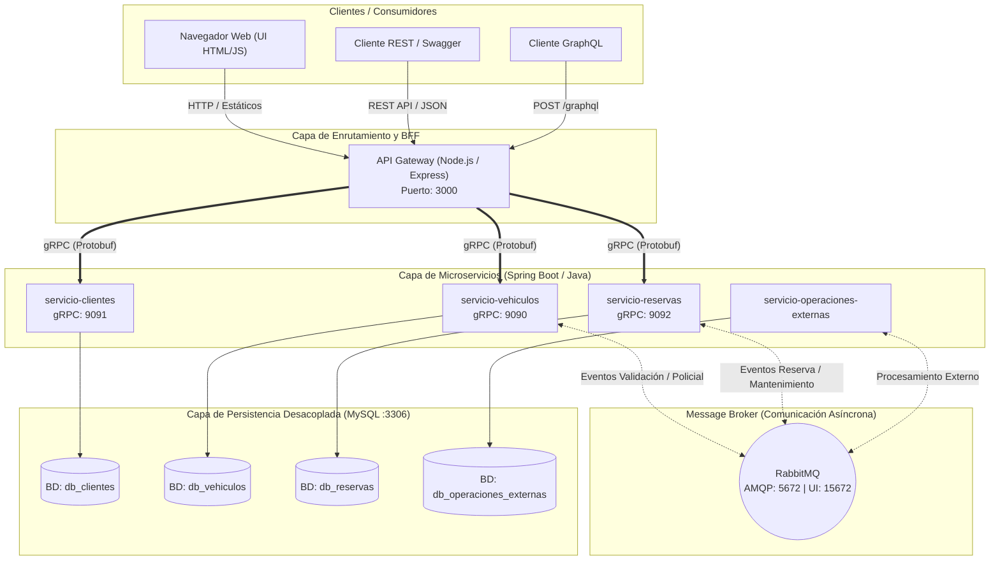

# Integrantes Grupo B
- Juan Martin Diez DNI 46335961
- Arian Savall DNI 46686015
- Santiago Zurlo DNI 46291432

# Sistema Distribuido de Gestión de Flota y Reservas Vehiculares

## 1. Título y Descripción General

### Resumen del Negocio
El **Sistema Distribuido de Gestión de Flota y Reservas Vehiculares** es una plataforma integral diseñada bajo una arquitectura de microservicios orientada a resolver la problemática de alquiler, préstamo y administración de flotas de vehículos (tanto propios de la organización como de terceros/externos).

El sistema resuelve los siguientes desafíos de negocio:
- **Gestión centralizada de disponibilidad y reservas:** Permite a los usuarios reservar vehículos validando solapamientos horarios y estados operativos.
- **Incorporación segura de flota externa:** Automatiza la validación de antecedentes policiales (denuncias de robo) y titularidad de dominio mediante flujos asíncronos antes de habilitar un vehículo externo.
- **Mantenimiento preventivo automatizado:** Evalúa de forma asíncrona el desgaste y estado mecánico tras las reservas para garantizar la seguridad de la flota, actualizando automáticamente la disponibilidad del vehículo y el estado de las reservas afectadas.
- **Interoperabilidad multicanal:** Ofrece una única puerta de enlace (API Gateway) que expone interfaces Web, API REST (documentada con OpenAPI/Swagger) y consultas flexibles mediante GraphQL.

---

### Diagrama de Arquitectura General

A continuación se presenta el diagrama de arquitectura del ecosistema. *(Nota: Puedes visualizar este diagrama directamente en GitHub/GitLab gracias al soporte nativo de Mermaid, o exportar su diseño a herramientas como Draw.io / Lucidchart)*.



---

## 2. Inventario de Microservicios

El repositorio está estructurado como un monorepo multi-módulo (Maven para los servicios Java y NPM para el Gateway). A continuación se detalla cada componente del ecosistema:

| Nombre del Servicio | Bounded Context / Responsabilidad | Lenguaje y Framework | Puertos por Defecto | Rutas Principales / Contratos y Documentación |
| :--- | :--- | :--- | :--- | :--- |
| **`api-gateway`** | Punto único de entrada (BFF), autenticación JWT, servidor de archivos estáticos (Frontend), orquestador gRPC, exposición de API REST y motor de consultas GraphQL. | Node.js (v18+) / Express, `@grpc/grpc-js`, `graphql` | **HTTP:** `3000` | • **Swagger / OpenAPI:** `/api-docs`<br>• **GraphQL:** `/graphql`<br>• **REST Auth:** `/api/auth/login`<br>• **REST Clientes:** `/api/clientes`<br>• **REST Vehículos:** `/api/vehiculos`<br>• **REST Reservas:** `/api/reservas`, `/api/disponibilidad`, `/api/historial`<br>• **Web UI:** `/index.html`, `/login.html`, etc. |
| **`servicio-clientes`** | Gestión de identidad, registro de usuarios, metadatos de clientes, asignación de roles (`ADMIN`, `CLIENTE`) y validación de credenciales. | Java 17+ / Spring Boot 3, Spring Data JPA, `grpc-spring-boot-starter` | **gRPC:** `9091`<br>| **Contrato gRPC:** `clientes.proto`<br>• `CrearUsuario`, `ObtenerUsuario`, `ActualizarUsuario`, `ListarUsuarios`, `ValidarCredenciales` |
| **`servicio-vehiculos`** | Administración del catálogo de flota (propia y externa), control de estados (`DISPONIBLE`, `EN_MANTENIMIENTO`, `PENDIENTE_VERIFICACION`, etc.) y emisión de eventos para validación externa. | Java 17+ / Spring Boot 3, Spring Data JPA, Spring AMQP (RabbitMQ), gRPC | **gRPC:** `9090`<br> | **Contrato gRPC:** `vehiculo.proto`<br>• `CrearVehiculo`, `RegistrarVehiculoExterno`, `ObtenerVehiculo`, `ListarVehiculos`, `ActualizarVehiculo`, `CambiarEstadoVehiculo` |
| **`servicio-reservas`** | Gestión del ciclo de vida de reservas (`PENDIENTE`, `CONFIRMADA`, `CANCELADA`, `FINALIZADA`), validación de disponibilidad por rango de fechas, historial y disparo de solicitudes de mantenimiento. | Java 17+ / Spring Boot 3, Spring Data JPA, Spring AMQP (RabbitMQ), gRPC | **gRPC:** `9092`<br> | **Contrato gRPC:** `reserva.proto`<br>• `CrearReserva`, `ConfirmarReserva`, `CancelarReserva`, `ObtenerReserva`, `ListarReservas`, `ConsultarDisponibilidad` |
| **`servicio-operaciones-externas`** | Simulación e integración con entes reguladores externos: verificación de denuncias policiales, validación de titularidad de patentes y ejecución de mantenimiento preventivo de flota. | Java 17+ / Spring Boot 3, Spring Data JPA, Spring AMQP (RabbitMQ)| <br>*(Worker asíncrono sin exposición pública)* | **Queues / Eventos RabbitMQ:**<br>• Escucha: Solicitudes de verificación policial, titularidad y confirmación de reservas.<br>• Publica: Resultados de verificación (`VerificacionResultadoEvent`) y de mantenimiento (`MantenimientoResultadoEvent`). |
| **`proto`** *(Módulo compartido)* | Biblioteca centralizada de contratos Protocol Buffers (`.proto`) que compila y genera los *stubs* gRPC para los microservicios en Java y provee definiciones al Gateway. | Protocol Buffers (`proto3`) / Maven | *N/A (Librería)* | Contratos en `/proto/contratos/`:<br>• `clientes/clientes.proto`<br>• `vehiculos/vehiculo.proto`<br>• `reservas/reserva.proto` |

---

## 3. Requisitos Previos y Entorno

### Herramientas Globales Obligatorias
Para ejecutar el proyecto de forma local (tanto contenerizado como en modo desarrollo aislado), asegúrate de contar con las siguientes herramientas:

- **Docker** (v20.10+) y **Docker Compose** (v2.0+): Obligatorio para levantar la infraestructura completa con un solo comando.
- **Java Development Kit (JDK) 17 o 21**: Requerido para compilar y ejecutar los microservicios Spring Boot localmente.
- **Apache Maven** (v3.8+): El repositorio incluye el wrapper `./mvnw` (`mvnw.cmd` en Windows), por lo que no es estrictamente necesario instalarlo de forma global.
- **Node.js** (v18+ LTS) y **npm** (v9+): Requerido para ejecutar el `api-gateway` de forma aislada.

### Variables de Entorno y Archivos `.env.example`
El proyecto utiliza dos archivos plantilla de variables de entorno que deben copiarse antes de iniciar el sistema:

1. **Raíz del proyecto (`.env.example` $\rightarrow$ `.env`):** Configura las credenciales de infraestructura para `docker-compose.yml` (MySQL, RabbitMQ y puertos de los servicios).
2. **Directorio del Gateway (`api-gateway/.env.example` $\rightarrow$ `api-gateway/.env`):** Configura los targets gRPC hacia los microservicios, el puerto HTTP y el secreto JWT.

#### Ejemplo de variables principales:
```env
# --- Infraestructura Base (Raíz .env) ---
MYSQL_ROOT_PASSWORD=root
MYSQL_PORT=3306

RABBITMQ_DEFAULT_USER=guest
RABBITMQ_DEFAULT_PASS=guest
RABBITMQ_PORT=5672
RABBITMQ_MANAGEMENT_PORT=15672

# --- Configuración API Gateway (api-gateway/.env) ---
PORT=3000
JWT_SECRET=super_secret_jwt_key_distribuidos
VEHICULOS_GRPC_URL=servicio-vehiculos:9090
CLIENTES_GRPC_URL=servicio-clientes:9091
RESERVAS_GRPC_URL=servicio-reservas:9092
```
*(Nota: Para ejecución local fuera de Docker, reemplaza los nombres de host de los servicios por `localhost:9091`, `localhost:9092` y `localhost:9093` respectivamente).*

---

## 4. Guía de Ejecución Local (Quick Start)

### Opción A: Levantar todo el ecosistema con un comando único (Recomendado)

1. Clona el repositorio y sitúate en la carpeta raíz:
   ```bash
   git clone <url-del-repositorio>
   cd TP-Distribuidos-Grupo-B-develop
   ```

2. Crea los archivos `.env` a partir de las plantillas `.env.example`:
   ```bash
   cp .env.example .env
   cp api-gateway/.env.example api-gateway/.env
   ```

3. Construye y levanta todos los contenedores (Bases de datos, RabbitMQ, Microservicios Java y API Gateway):
   ```bash
   docker compose up --build -d
   ```

4. Verifica que todos los contenedores estén en estado `Up` / `healthy`:
   ```bash
   docker compose ps
   ```

5. **Accesos rápidos una vez iniciado:**
   - 🌐 **Aplicación Web (Frontend):** [http://localhost:3000](http://localhost:3000)
   - 📄 **Documentación Swagger / OpenAPI:** [http://localhost:3000/api-docs](http://localhost:3000/api-docs)
   - 🔍 **Endpoint GraphQL:** `http://localhost:3000/graphql`
   - 🐰 **Consola de RabbitMQ:** [http://localhost:15672](http://localhost:15672) *(Usuario/Pass por defecto: `guest` / `guest`)*

Para detener todo el ecosistema:
```bash
docker compose down
```

---

### Opción B: Levantar un microservicio de forma aislada en modo Desarrollo

Si deseas depurar o desarrollar sobre un microservicio específico sin empaquetar todo en Docker:

1. **Levanta únicamente la infraestructura de soporte (MySQL y RabbitMQ):**
   ```bash
   docker compose up -d mysql rabbitmq
   ```

2. **Compila e instala el módulo compartido `proto` en tu repositorio Maven local (`.m2`):**
   *(Este paso es obligatorio antes de correr cualquier microservicio Java por primera vez o tras modificar un archivo `.proto`).*
   ```bash
   ./mvnw clean install -pl proto
   ```

3. **Ejecuta el microservicio Java deseado (ejemplo con `servicio-vehiculos`):**
   ```bash
   ./mvnw spring-boot:run -pl servicio-vehiculos
   ```
   *(El servicio tomará la configuración de su archivo `src/main/resources/application.yaml`, conectándose a `localhost:3306` y `localhost:5672`).*

4. **Ejecuta el `api-gateway` en modo desarrollo (Node.js):**
   ```bash
   cd api-gateway
   npm install
   # Asegúrate de apuntar las variables *_GRPC_URL a localhost en tu archivo api-gateway/.env
   npm run dev
   ```

---

## 5. Estrategia de Comunicación y Enrutamiento

El sistema implementa una arquitectura de comunicación híbrida que combina lo mejor del rendimiento síncrono binario con el desacoplamiento asíncrono orientado a eventos:

### 1. Comunicación Síncrona (gRPC + Protocol Buffers)
- Todas las peticiones que ingresan al **API Gateway** (ya sean llamadas REST desde la interfaz web o consultas **GraphQL**) son traducidas internamente e invocadas hacia `servicio-clientes`, `servicio-vehiculos` y `servicio-reservas` mediante **gRPC sobre HTTP/2**.
- El uso de contratos tipados en `/proto/contratos/` garantiza baja latencia en la red interna y validación estricta de esquemas entre Node.js y Java.

### 2. Comunicación Asíncrona (Event-Driven vía RabbitMQ)
Los procesos de larga duración o que requieren integración con dominios externos se resuelven de manera completamente desacoplada a través de intercambios (*Exchanges*) y colas (*Queues*) en **RabbitMQ**:

- **Flujo de Alta y Verificación de Vehículos Externos:**
   1. Cuando se registra un vehículo externo en `servicio-vehiculos`, este se guarda con estado inicial pendiente y publica los eventos `VehiculoExternoRegistradoEvent` / `VerificacionSolicitadaEvent`.
   2. `servicio-operaciones-externas` consume dichos eventos a través de `RegistroPolicialListener`, verifica en su base de datos si existen denuncias policiales (`DenunciaPolicial`) y valida la titularidad (`TitularidadVehiculo`).
   3. Una vez procesado, emite un `VerificacionResultadoEvent` (y validaciones de patente/titularidad).
   4. `servicio-vehiculos` escucha la respuesta mediante `VehiculoRabbitListener` y actualiza automáticamente el estado del vehículo a `DISPONIBLE` o `RECHAZADO`.

- **Flujo de Reservas y Mantenimiento Preventivo:**
   1. Cuando se confirma o procesa una reserva en `servicio-reservas`, el servicio emite un `ReservaConfirmadaEvent` mediante `ReservaEventosService`.
   2. `servicio-operaciones-externas` escucha este evento en `MantenimientoListener`, ejecuta la lógica de evaluación en `MantenimientoPreventivoService` y registra una `SolicitudMantenimiento`.
   3. Al concluir el chequeo, publica el evento `MantenimientoResultadoEvent` con el resultado (`APROBADO`, `REQUIERE_REPARACION`, etc.).
   4. Tanto `servicio-reservas` como `servicio-vehiculos` escuchan este resultado para actualizar el estado de la reserva y colocar el vehículo en estado `EN_MANTENIMIENTO` o `DISPONIBLE` según corresponda.

### 3. Configuración del API Gateway y Proxy / BFF
El componente `api-gateway` actúa como un **Backend for Frontend (BFF)** y Gateway unificado:
- **Seguridad y Autenticación (`src/auth.js`):** Valida credenciales contra `servicio-clientes` vía gRPC y emite tokens **JWT** para proteger las rutas privadas.
- **Adaptador REST y OpenAPI (`src/*-routes.js`, `src/openapi.js`):** Expone endpoints RESTful estandarizados y genera la especificación interactiva en `/api-docs`.
- **Agregador GraphQL (`src/graphql.js`):** Permite consultar en una sola petición HTTP datos combinados de Reservas, Clientes y Vehículos resolviendo las relaciones internamente mediante llamadas gRPC paralelas.

---

## 6. Bases de Datos y Persistencia

### Encapsulamiento por Dominio (Database-per-Service)
Siguiendo las buenas prácticas de diseño de microservicios y **evitando el antipatrón de Base de Datos Compartida**, cada microservicio posee y encapsula su propio esquema lógico de datos de manera estricta. Ningún servicio realiza consultas SQL cruzadas (*JOINs* entre dominios) hacia las tablas de otro microservicio:

- **`servicio-clientes`** $\rightarrow$ Esquema exclusivo para `Usuario` y `UsuarioMetaDatos`.
- **`servicio-vehiculos`** $\rightarrow$ Esquema exclusivo para `Vehiculo` y sus estados de validación.
- **`servicio-reservas`** $\rightarrow$ Esquema exclusivo para `Reserva` (almacena únicamente los IDs de referencia `usuarioId` y `vehiculoId`).
- **`servicio-operaciones-externas`** $\rightarrow$ Esquema exclusivo para `DenunciaPolicial`, `TitularidadVehiculo` y `SolicitudMantenimiento`.

*(Nota de infraestructura local: En el entorno `docker-compose.yml`, por simplicidad de recursos de desarrollo, se utiliza una única instancia del motor MySQL en el puerto `3306`, pero aprovisionando bases de datos/esquemas lógicos independientes para cada microservicio).*

### Inicialización, Migración y Datos de Prueba (Seeds)
La inicialización y migración de las bases de datos se realiza de forma automática mediante tres mecanismos combinados:

1. **Scripts SQL de Inicialización en Docker (`docker/mysql/001-mock-data.sql`):**
   Al levantar el contenedor de MySQL por primera vez, el motor ejecuta automáticamente todos los scripts montados en `/docker-entrypoint-initdb.d/`, creando los esquemas correspondientes e insertando el lote inicial de datos de prueba (*mock data*) para usuarios, vehículos y reservas.
2. **Auto-migración de Esquemas con Hibernate / JPA:**
   Cada microservicio Spring Boot está configurado en su `application.yaml` con `spring.jpa.hibernate.ddl-auto: update`, lo que permite que Hibernate cree o actualice las tablas automáticamente al iniciar cada aplicación en función de las clases `@Entity`.
3. **Sembrado Programático (`DataInitializer.java`):**
   El microservicio `servicio-operaciones-externas` cuenta con el componente `DataInitializer` (implementando `CommandLineRunner`), el cual verifica al arrancar si las tablas de registros policiales y titularidades están vacías y las puebla automáticamente con patentes válidas y patentes con denuncias de prueba para facilitar el testing de los flujos asíncronos.
# API Gateway de Rentar

Node.js + Express recibe REST, GraphQL y la interfaz web. Los clientes gRPC cargan
los contratos del directorio `../proto/contratos`. El Gateway no abre conexiones a bases de
datos: la persistencia, precios, disponibilidad y validaciones de dominio pertenecen
a los servicios Java.

## Requisitos y arranque

Node.js 24 y npm. Ejecutar desde `api-gateway`:

```bat
npm start
```

Abrir http://localhost:3000. La demostración levanta los tres servicios gRPC
simulados y la web en un solo proceso, sin MySQL ni otras ventanas. Usa puertos gRPC
libres, aunque exista un `.env` con direcciones reales. Cerrar con Ctrl+C.
Si el puerto 3000 está ocupado, detener el Gateway anterior o configurar `PORT`.

Credenciales **ficticias, sólo para la demostración**:

| Usuario | Clave | Rol |
|---|---|---|
| admin_prueba | clave-prueba | ADMIN |
| cliente_prueba | clave-prueba | CLIENTE |
| cliente_dos | clave-prueba | CLIENTE |

Los datos y sesiones se pierden al cerrar. Los importes y reglas de los simuladores
no validan el comportamiento de los servicios Java. Las rutas de edición y
reactivación de vehículos muestran un error mientras falten operaciones en el
contrato real; el simulador no inventa un contrato distinto.

## Servicios reales

1. Incorporar los cambios acordados del grupo a la rama propia.
2. Implementar los pendientes de [integración](docs/integracion-pendiente.md).
3. Si todavía no existe `.env`, copiar `.env.example` a `.env` y configurar
   `VEHICULOS_GRPC_ADDR`, `CLIENTES_GRPC_ADDR` y `RESERVAS_GRPC_ADDR` con los puertos
   **gRPC**, no HTTP, de los servicios. No sobrescribir un `.env` existente.
4. Levantar los servicios Java y sus bases siguiendo las instrucciones de sus autores.
5. Ejecutar `npm start` desde `api-gateway`. Este comando usa servicios reales y no
   arranca simuladores ni cambia automáticamente a ellos si una conexión falla.

Puertos publicados: Vehículos `127.0.0.1:9090`, Clientes
`127.0.0.1:9091`, Reservas `127.0.0.1:9092`, Frontend `127.0.0.1:3000`, RabbitMQ `127.0.0.1:5672`.

El login usa `validarLogin` de Clientes. Como devuelve el ID de metadatos, se consulta
`ListarUsuarios` tras validar las credenciales para obtener el ID del cliente correcto.
El Gateway mantiene la sesión y descarta las contraseñas/hashes recibidos.

`PORT` es opcional (3000 por defecto). `SESSION_SECRET` es opcional en desarrollo;
si no está definido se genera un secreto al arrancar. Las sesiones se guardan en
memoria con vigencia de dos horas. Reiniciar requiere volver a iniciar sesión.
La cookie es HttpOnly y SameSite=Strict. Esta configuración es para ejecución local
por HTTP; un despliegue externo requiere HTTPS, cookie Secure y almacenamiento de
sesiones adecuado. No guardar contraseñas en código ni en el historial de Git.

## Interfaz conservada

Las pantallas originales del Hito 1 están en `resources/templates` como referencia.
`public/` adapta su HTML/CSS a Node y reemplaza Thymeleaf por llamadas al Gateway:

- `/login` y `/`: inicio de sesión y panel.
- `/clientes` y `/clientes/editar/:id`: administración de clientes.
- `/vehiculos` y `/vehiculos/editar/:patente`: administración de vehículos.
- `/reservas`: disponibilidad, alta, filtros y cancelación.
- `/historial`: alquileres del cliente autenticado.

La autorización también se verifica en el servidor. Un CLIENTE no puede administrar
clientes o vehículos, indicar otro cliente para una reserva ni cancelar una reserva
ajena. ADMIN consulta reservas de todos y puede usar el DNI para crear una reserva.
El historial personal requiere CLIENTE.

## REST

Todas las API salvo login/health requieren la cookie de sesión.

| Método | Ruta | Uso |
|---|---|---|
| POST | /auth/login | JSON `{usuario,password}` → sesión e identidad |
| GET | /auth/me | Identidad autenticada |
| POST | /auth/logout | Invalida sesión y cookie |
| GET | /health | Estado del proceso, no de sus dependencias |
| GET/POST | /api_rest/v1/clientes | Listar/crear (ADMIN) |
| GET | /api_rest/v1/clientes/buscar/id/:id | Consultar por ID (ADMIN) |
| GET | /api_rest/v1/clientes/buscar/dni/:dni | Consultar por DNI (ADMIN) |
| PATCH | /api_rest/v1/clientes/modificar/id/:id | Modificar (ADMIN) |
| PATCH | /api_rest/v1/clientes/modificar/dni | Modificar con DNI en JSON (ADMIN) |
| DELETE | /api_rest/v1/clientes/borrar/id/:id | Baja por ID (ADMIN) |
| DELETE | /api_rest/v1/clientes/borrar/dni/:dni | Baja por DNI (ADMIN) |
| GET | /api_rest/v1/vehiculos/getAll | Listar vehículos |
| GET | /api_rest/v1/vehiculos/:patente | Consultar vehículo |
| POST | /api_rest/v1/vehiculos/create | Alta (ADMIN) |
| POST | /api_rest/v1/vehiculos/desactivar | Baja, JSON `{patente}` (ADMIN) |
| PUT | /api_rest/v1/vehiculos/:patente | Pendiente de contrato identificable, 501 (ADMIN) |
| POST | /api_rest/v1/vehiculos/activar | Pendiente de RPC, 501 (ADMIN) |
| POST | /api_rest/v1/reservas | Alta: idVehiculo o patenteVehiculo, fechaHoraInicio/Final |
| PUT | /api_rest/v1/reservas/:id | Cancelar (propietario o ADMIN) |

Alta de cliente admite dni, nombre, apellido, email, telefono, fechaNacimiento y
metadatos.usuario/password. No admite asignar rol, ID o estado desde el navegador.
Las respuestas nunca exponen contraseñas. Errores de gRPC se traducen a HTTP:
INVALID_ARGUMENT→400, NOT_FOUND→404, ALREADY_EXISTS/FAILED_PRECONDITION→409,
UNAUTHENTICATED→401, PERMISSION_DENIED→403, UNAVAILABLE→503,
DEADLINE_EXCEEDED→504, UNIMPLEMENTED→501. Cada RPC tiene un límite de 5 segundos.

## API GraphQL
 
**Endpoint:** `POST http://localhost:3000/graphql`, con cuerpo JSON `{"query": "...", "variables": {...}}`.
 
La identidad del usuario sale siempre de la sesión y nunca de un parámetro, así que ningún filtro amplía los permisos. Los errores se devuelven en el campo `errors`, con un código en `extensions.code`.
 
El schema está documentado con descripciones en el propio código (`api-gateway/src/graphql.js`), y se puede consultar por introspección. Por ejemplo:
 
```json
{ "query": "{ __type(name: \"Reserva\") { description fields { name description } } }" }
```
 
### Consultas disponibles
 
| Consulta | Rol | Qué devuelve |
|---|---|---|
| `vehiculosDisponibles` | <!-- VERIFICAR: ¿exige sesión? --> | Vehículos libres durante todo el período indicado |
| `vehiculos` | <!-- VERIFICAR: ¿exige sesión? --> | Vehículos activos de la flota |
| `reservas` | `ADMIN` y `CLIENTE` | Reservas, con alcance según el rol |
| `miHistorialAlquileres` | solo `CLIENTE` | Historial del cliente de la sesión |
 
### `vehiculosDisponibles`
 
Devuelve los vehículos activos y habilitados que no tienen reservas confirmadas que se solapen con el período. Las reservas canceladas no bloquean.
 
| Parámetro | Tipo | Obligatorio | Descripción |
|---|---|---|---|
| `fechaInicio` | String | Sí | Inicio del período. Formato `yyyy-MM-ddTHH:mm`, sin zona horaria |
| `fechaFinal` | String | Sí | Fin del período. Mismo formato, posterior a `fechaInicio` |
| `tipo` | TipoVehiculo | No | `SEDAN`, `SUV`, `PICKUP`, `COUPE` o `HATCHBACK` |
| `marca` | String | No | Marca exacta |
| `modelo` | String | No | Modelo exacto |
| `precioMin` | Float | No | Precio diario mínimo |
| `precioMax` | Float | No | Precio diario máximo. Si se omite, no hay tope |
 
Campos devueltos: `id`, `patente`, `marca`, `modelo`, `anio`, `color`, `tipoVehiculo`, `precioDiario`.
 
Errores: `BAD_USER_INPUT` (fecha inválida), `SERVICIO_VEHICULOS_ERROR`.
 
```graphql
query {
  vehiculosDisponibles(
    fechaInicio: "2028-06-01T10:00"
    fechaFinal: "2028-06-05T10:00"
    tipo: SEDAN
    precioMax: 50000
  ) {
    patente
    marca
    modelo
    tipoVehiculo
    precioDiario
  }
}
```
 
### `reservas`
 
Devuelve las reservas con el nombre del cliente y la marca y modelo del vehículo ya resueltos. El gateway combina datos de los servicios de reservas, clientes y vehículos. Ordena de la reserva más reciente a la más antigua por fecha de inicio.
 
- `ADMIN`: ve las reservas de todos los clientes.
- `CLIENTE`: ve solamente las propias, sin importar los filtros.
Parámetro: `filtros` (opcional), de tipo `FiltroReservasInput`. Los filtros se combinan con AND.
 
| Filtro | Tipo | Descripción | Quién lo aplica |
|---|---|---|---|
| `dniCliente` | String | DNI del cliente | Solo `ADMIN` (un `CLIENTE` lo ignora) |
| `patenteVehiculo` | String | Patente exacta | `ADMIN` y `CLIENTE` |
| `tipoVehiculo` | TipoVehiculo | Tipo del vehículo reservado | `ADMIN` y `CLIENTE` |
| `estado` | EstadoReserva | `CONFIRMADO` o `CANCELADO` | `ADMIN` y `CLIENTE` |
| `fechaDesde` | String | Reservas que terminan en esa fecha o después | `ADMIN` y `CLIENTE` |
| `fechaHasta` | String | Reservas que empiezan en esa fecha o antes | `ADMIN` y `CLIENTE` |
 
Las fechas usan formato ISO local sin zona horaria (`yyyy-MM-ddTHH:mm[:ss]`), y `fechaDesde` no puede ser posterior a `fechaHasta`.
 
Campos devueltos:
 
| Campo | Tipo | Descripción |
|---|---|---|
| `id` | ID | Identificador de la reserva |
| `cliente` | String | Nombre y apellido |
| `vehiculo` | String | Marca y modelo |
| `patente` | String | Patente del vehículo |
| `fechaInicio` | String | Inicio del alquiler |
| `fechaFinalizacion` | String | Fin del alquiler |
| `precioDiario` | Float | Precio por día |
| `importeTotal` | Float | Importe total de la reserva |
| `estado` | EstadoReserva | `CONFIRMADO` o `CANCELADO` |
| `estadoMantenimiento` | String | `PENDIENTE`, `REALIZADO` o `NO_REALIZADO` |
 
Errores: `UNAUTHENTICATED`, `FORBIDDEN`, `BAD_USER_INPUT`, `SERVICIO_RESERVAS_ERROR`. Si falla alguno de los servicios, devuelve un error y no una lista vacía.
 
```graphql
query ($f: FiltroReservasInput) {
  reservas(filtros: $f) {
    cliente
    vehiculo
    patente
    fechaInicio
    importeTotal
    estado
    estadoMantenimiento
  }
}
```
 
Variables:
 
```json
{ "f": { "estado": "CONFIRMADO", "patenteVehiculo": "AC222FF" } }
```
 
Respuesta de ejemplo:
 
```json
{
  "data": {
    "reservas": [
      {
        "cliente": "Super Admin",
        "vehiculo": "Chevrolet Camaro",
        "patente": "AC222FF",
        "fechaInicio": "2027-12-11T11:11",
        "importeTotal": 45000,
        "estado": "CONFIRMADO",
        "estadoMantenimiento": "REALIZADO"
      }
    ]
  }
}
```
 
### `miHistorialAlquileres`
 
Devuelve el historial del cliente autenticado: las reservas canceladas y las reservas confirmadas cuyo período ya terminó. Va ordenado de la más reciente a la más antigua. No recibe parámetros: el cliente sale de la sesión.
 
| Campo | Tipo | Descripción |
|---|---|---|
| `vehiculo` | String | Marca y modelo |
| `patente` | String | Patente del vehículo |
| `fechaInicio` | String | Inicio del alquiler |
| `fechaFinalizacion` | String | Fin del alquiler |
| `cantidadDias` | Int | Días del alquiler, con mínimo de 1 |
| `importeTotal` | Float | Importe total |
| `estado` | String | `CANCELADO`, o `FINALIZADO` (confirmada con período terminado) |
 
`FINALIZADO` no se guarda en la base: se deriva de la fecha de fin.
 
Errores: `UNAUTHENTICATED`, `FORBIDDEN` (un `ADMIN` no puede usarla), `SERVICIO_RESERVAS_ERROR`.
 
```graphql
query {
  miHistorialAlquileres {
    vehiculo
    patente
    fechaInicio
    cantidadDias
    importeTotal
    estado
  }
}
```
 
Respuesta de ejemplo:
 
```json
{
  "data": {
    "miHistorialAlquileres": [
      {
        "vehiculo": "Chevrolet Camaro",
        "patente": "AC222FF",
        "fechaInicio": "2027-10-30T11:11",
        "cantidadDias": 1,
        "importeTotal": 45000,
        "estado": "CANCELADO"
      },
      {
        "vehiculo": "Chevrolet Camaro",
        "patente": "AC222FF",
        "fechaInicio": "2026-10-10T07:00",
        "cantidadDias": 2,
        "importeTotal": 90000,
        "estado": "FINALIZADO"
      }
    ]
  }
}
```
 
Error de ejemplo (un `ADMIN` pide el historial):
 
```json
{
  "errors": [
    { "message": "El historial requiere el rol CLIENTE", "extensions": { "code": "FORBIDDEN" } }
  ],
  "data": null
}
```
 
### Restricciones de acceso por rol
 
| Consulta | Sin sesión | `ADMIN` | `CLIENTE` |
|---|---|---|---|
| `reservas` | `UNAUTHENTICATED` | Todas las reservas | Solo las propias |
| `miHistorialAlquileres` | `UNAUTHENTICATED` | `FORBIDDEN` | Su historial |

## Ejecutar las pruebas

En Windows:

```powershell
.\mvnw.cmd test
```

En Linux o macOS:

```bash
./mvnw test
```

## Notas

- Las contraseñas se almacenan utilizando BCrypt.
- Las rutas REST y GraphQL requieren autenticación.
- La base de datos debe estar disponible antes de iniciar la aplicación.
- Los esquemas GraphQL se encuentran en `graphql`.
- La configuración sensible se obtiene desde variables de entorno mediante `.env`.
